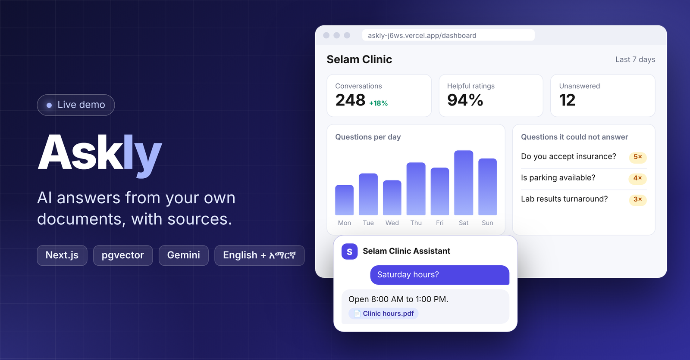

<h1 align="center">Askly 💬</h1>

<p align="center">
  An embeddable AI chat widget that answers only from a business's own documents.<br>
  Cited answers, English and Amharic, and an honest "I don't know" when the answer isn't there.
</p>

<p align="center">
  <a href="https://askly-j6ws.vercel.app"><b>Live demo</b></a>
</p>

<p align="center">
  
  
  
  
  
</p>

---

## Table of contents

- [About](#about)
- [Features](#features)
- [How it works](#how-it-works)
- [Tech stack](#tech-stack)
- [Project structure](#project-structure)
- [Getting started](#getting-started)
- [Environment variables](#environment-variables)
- [Embed the widget](#embed-the-widget)
- [Deployment](#deployment)
- [Roadmap](#roadmap)
- [Author](#author)

## About

Most website chatbots make things up. **Askly** only answers from the documents a business uploads (FAQs, price lists, policies, service pages). If the answer isn't in those documents, it says so and logs the question so the owner can fill the gap.

A business signs up, uploads its documents, copies one script tag, and pastes it into its website. Visitors get a chat widget that answers in English or Amharic with sources they can check.

The live demo uses a sample business, **Selam Clinic**, so you can try the widget and the owner dashboard with realistic data.

## Features

**For visitors**
- Ask a question and get an answer grounded in the business's own documents
- Every answer shows the passages it came from
- Works in English and Amharic
- Says "I don't know" instead of guessing
- Rate an answer with a thumbs up or down

**For business owners**
- Upload and manage documents
- Dashboard with usage, visitor ratings and the questions the assistant could not answer
- Allowed-domains list so only your own site can use your widget
- One script tag to embed the widget on any website

**Platform**
- Semantic search over document chunks with pgvector
- Retrieval-augmented generation (RAG) with the Gemini API
- Authentication with Supabase
- Strict CORS for the dashboard API, open access only for the widget routes

## How it works

```text
Document upload ─► split into chunks ─► embeddings ─► stored in PostgreSQL (pgvector)

Visitor question ─► embedding ─► nearest chunks (semantic search)
                            └─► Gemini answers using only those chunks
                            └─► answer + sources, or "I don't know" and the question is logged
```

## Tech stack

### Client (`client/`)
- Next.js and React
- TypeScript
- Deployed on Vercel

### Server (`server/`)
- Node.js and Express
- TypeScript
- Serves the API and the built widget file
- Deployed on Railway

### Widget (`widget/`)
- TypeScript, bundled with esbuild into a single script
- Copied into `server/public/widget` at build time

### Data and AI
- PostgreSQL with pgvector (Supabase)
- Gemini API for embeddings and answers

## Project structure

```text
askly/
├── client/                # Next.js dashboard and landing page
├── server/                # Express API
│   ├── src/
│   │   └── server.ts      # Server entry point
│   └── public/widget/     # Built widget, served at /widget
├── widget/                # Embeddable chat widget source
│   ├── src/
│   └── package.json       # build script bundles and copies the widget to server
├── docs/                  # README images
└── README.md
```

## Getting started

### Prerequisites

- Node.js 20 or newer and npm
- A Supabase project (PostgreSQL with the `vector` extension enabled)
- A Gemini API key

### 1. Clone the repository

```bash
git clone YOUR_GITHUB_REPOSITORY_URL
cd askly
```

### 2. Install dependencies

```bash
cd server && npm install
cd ../client && npm install
cd ../widget && npm install
```

### 3. Create your environment files

Copy the example files and fill in your own values. **Never commit them to GitHub.**

```bash
cp server/.env.example server/.env
cp client/.env.example client/.env.local
```

### 4. Build the widget

```bash
cd widget
npm run build
```

This bundles the widget and copies it to `server/public/widget/askly.js`.

### 5. Run the server and the client

```bash
# Terminal 1
cd server
npm run dev

# Terminal 2
cd client
npm run dev
```

Open **http://localhost:3000**. Check the server at **http://localhost:3001/health**.

## Environment variables

Use the `.env.example` files as the source of truth. The ones you will always need:

**Server**

| Variable | Purpose |
|---|---|
| `PORT` | Port the API listens on (3001 locally, set by the host in production) |
| `CLIENT_ORIGINS` | Comma-separated dashboard origins allowed by CORS |
| Database and Supabase keys | Connect to PostgreSQL and verify users |
| Gemini API key | Embeddings and answers |

**Client**

| Variable | Purpose |
|---|---|
| `NEXT_PUBLIC_API_URL` | Public URL of the server API |
| Supabase URL and public key | Sign-in from the browser |
| `NEXT_PUBLIC_DEMO_KEY` | Widget key for the demo business (optional) |

> Variables that start with `NEXT_PUBLIC_` are baked into the client at build time and are visible in the browser. Never put secrets in them.

## Embed the widget

Add one script tag to any page. The key identifies your business, and the page's domain must be in your allowed-domains list.

```html
<script
  src="https://YOUR_SERVER_URL/widget/askly.js"
  data-key="YOUR_WIDGET_KEY"
  defer
></script>
```

## Deployment

| Part | Host | Notes |
|---|---|---|
| Server | Railway | Root directory `server`, health check at `/health` |
| Client | Vercel | Root directory `client`, set `NEXT_PUBLIC_*` variables before building |
| Database | Supabase | PostgreSQL with pgvector |

After deploying, add the client's production URL to `CLIENT_ORIGINS` on the server and to the allowed redirect URLs in Supabase.

## Roadmap

- [x] Document upload and chunking
- [x] Semantic search with pgvector
- [x] Cited answers with the Gemini API
- [x] English and Amharic support
- [x] Embeddable widget
- [x] Owner dashboard with usage, ratings and unanswered questions
- [x] Allowed-domains protection
- [x] Deploy the server, client and demo business
- [ ] Conversation history export
- [ ] More document formats
- [ ] Widget theme and color settings

## Author

**Mesud Ali**

[GitHub](https://github.com/m3sudx)

---

<p align="center">
  
</p>